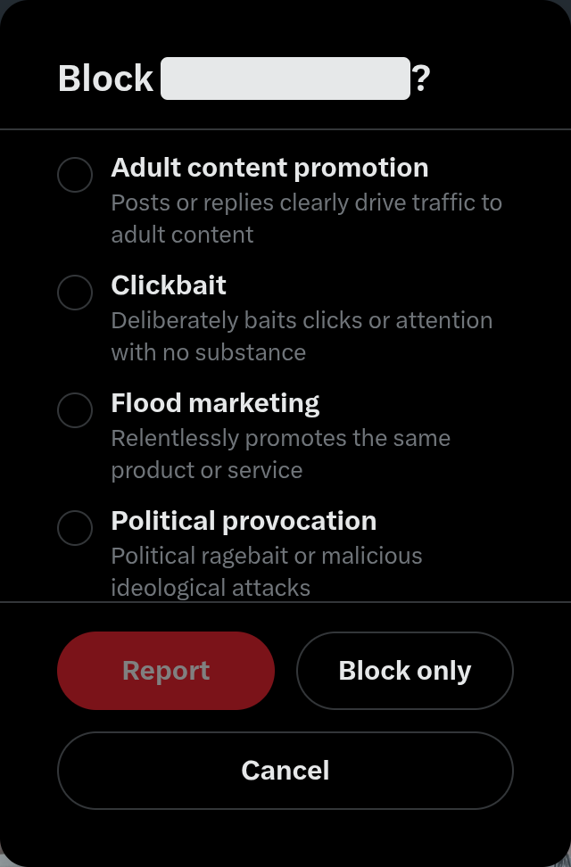
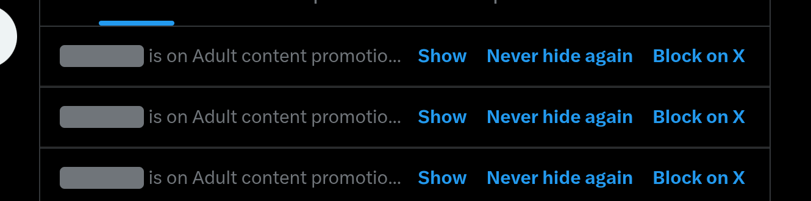

# Xlear

**A shared blocklist for X (Twitter).** Subscribe to the filter lists you care about, and posts from
listed accounts are hidden while you browse.

_[中文](README.zh.md)_

<a href="https://addons.mozilla.org/firefox/addon/xlear/"></a>

## Why

Open X for two minutes and you meet the same thing: reply bots, engagement bait, scam links,
and the odd account that shows up under every post. Blocking them one by one is endless work —
and thousands of people are doing the exact same blocking, by hand, every day.

Xlear turns that into a shared list. One person reports a spam account, an AI checks the evidence
before it goes in, and from then on everyone subscribed to that list stops seeing it.

## What it does

- **Hides the noise.** Posts from listed accounts are hidden right in the timeline, with a small card
  in their place. Show restores that post; Never hide again allows the account on this device.
- **Turns blocking into a report.** When you click Block on X, X's confirmation dialog is replaced by a
  short reason picker built from the lists you subscribe to. Pick one and confirm — X sends the block,
  and the report goes to the platform for review.
- **Remembers your reasons.** Recently confirmed reasons appear first. Use last selects the previous
  available reasons with one click; you still confirm the report. This history stays on your device,
  survives browser restarts and excludes disabled or unsubscribed lists. Cancelling leaves it unchanged.
  The picker follows X's light, dark and dim backgrounds, including theme changes while it is open.
- **Stays out of the way.** It works with X's own interface: nothing new to learn, no separate app,
  no fake buttons.
- **Only hides.** Xlear never blocks, mutes or posts on its own. The block request is always sent by X,
  after you confirm it.
- **You decide what is shared.** Online submission is on by default and can be turned off in
  Settings → General: the extension then only reads the shared lists, and reports and new lists stay
  on your device.
- **Speaks your language.** English, 中文, 日本語, Русский.

Local lists remain available when the server is offline. Unsubscribing stops a list from filtering
while retaining its cache for later use. If a local list becomes an online list, its enabled state is
preserved and each reason keeps its own post evidence. The master switch also disables the reason picker.

File backups and WebDAV transfers include local list names, reasons, membership and enabled states.
Imports merge with existing data; existing list settings win conflicts, and repeated imports do not
duplicate queued reports. Invalid backups are rejected before storage changes. Older backups remain
readable, but missing list definitions or ambiguous historical evidence cannot be reconstructed.

## The filter lists

| List | What it catches |
| --- | --- |
| Flood marketing | Relentlessly promotes the same product or service |
| Empty reply bot | Meaningless summaries or add-ons when replying, with AI-text traits |
| Low-effort hostility | Offensive, mocking or heated disagreement that misses the point |
| Fraud & sexual solicitation | Posts or replies involve clear fraud or solicitation of sexual services |
| Adult content promotion | Posts or replies clearly drive traffic to adult content |
| Clickbait | Deliberately baits clicks or attention with no substance |
| Political provocation | Political ragebait or malicious ideological attacks |
| Polarisation & extremism | Deliberately stirs division, baseless extremes or irrational defences |

You choose which lists to apply — nothing is on by default. Accounts land in a list only after review,
and every listed account can be appealed on the website.

## Screenshots

<table>
  <tr>
    <td valign="top"></td>
    <td valign="top"></td>
  </tr>
</table>

## Mobile browsing

Xlear recognizes both desktop and mobile X.com web layouts, including mobile posts without the
desktop tweet markers. The filter card wraps its actions for small screens, and the reason picker
keeps its buttons reachable when the visible viewport shrinks. English, Chinese, Japanese and
Russian layouts are checked at widths down to 320 CSS pixels.

Use a browser that can run this extension on the device. Xlear operates on web pages, not inside
the native X app. The **Block on X** action appears only when the page exposes a supported native
block entry point; the read-only mobile page can still hide posts, show a post and allow an account.

Mobile page recognition and filtering were checked with the built Chromium extension on a public,
logged-out X page using a mobile user agent. Firefox builds are validated; Android/iOS device
installation and authenticated X blocking were not part of that verification.

## Install (release builds)

Installs come from [Releases](https://github.com/LaneSun/xlear-extension/releases) or from
[addons.mozilla.org](https://addons.mozilla.org/firefox/addon/xlear/):

- Firefox, **signed by AMO**: install it from
  [addons.mozilla.org](https://addons.mozilla.org/firefox/addon/xlear/). Releases no longer attach a
  signed xpi — every version is submitted to the public listing instead (see `docs/RELEASING.md`).
- `xlear-extension-X.Y.Z.xpi` — Firefox unsigned: release Firefox only installs AMO-signed
  extensions; use Developer Edition / Nightly with `xpinstall.signatures.required = false`,
  or sign it on AMO yourself.
- `xlear-extension-X.Y.Z.crx` — Chromium browsers. Off-store CRX installs are blocked (the source is
  blocked, not the signature), so this is an enterprise-policy install on managed devices — and it
  **auto-updates** from the policy's update URL:
  ```
  jphaecjdabihkdhglojhfihdhnbibmci;https://github.com/LaneSun/xlear-extension/releases/latest/download/updates.xml
  ```
- `xlear-extension-X.Y.Z-chrome.zip` — unzip, then "Load unpacked" in `chrome://extensions`.

Every release ships `SHA256SUMS` alongside the artifacts; the pipeline is documented in `docs/RELEASING.md`.

## Development

Build conventions, module map and gotchas: [AGENTS.md](AGENTS.md).

Run `pnpm run compile`, `pnpm run build` and `pnpm run build:firefox`. Browser regressions live in
`scripts/verify-mobile.mjs` (local X fixtures) and `scripts/verify-extension.mjs` (a fresh browser
profile with the built Chromium extension). They require Playwright and Chromium; set
`XLEAR_PLAYWRIGHT` to its module path and `XLEAR_CHROMIUM` to the browser executable when they are not
on the default paths. Both scripts use local test data and mocked service responses.

`scripts/verify-dialog-preferences.mjs` loads the built extension into a fresh profile and checks
theme changes, recent-reason ordering, quick reuse, cancellation and persistence across browser restarts.
X pages and service responses are local fixtures; it does not use an X account.

License: UNLICENSE (public domain).
