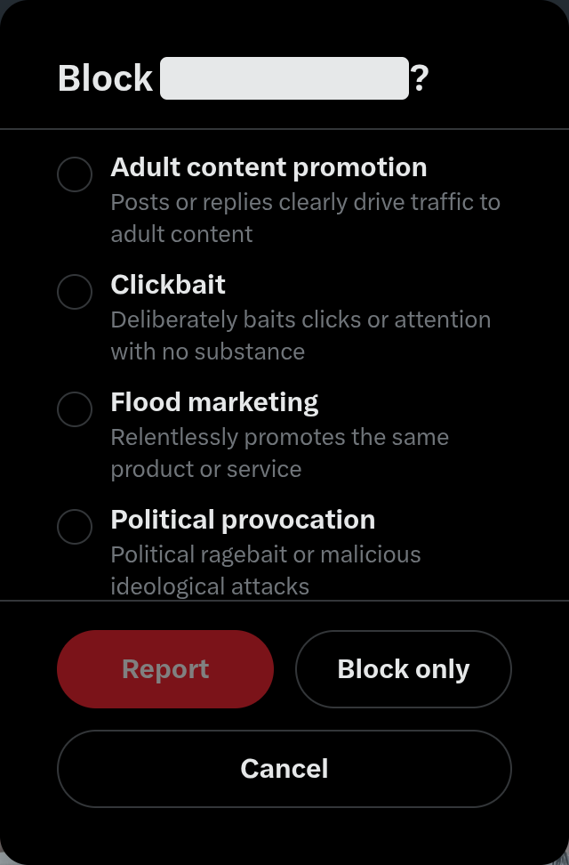
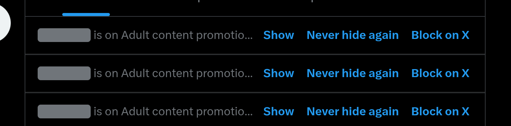

# Xlear

**X（Twitter）的共享屏蔽名单。** 订阅你关心的过滤列表，命中名单的账号，其帖子在浏览时自动隐藏。

_[English](README.md)_

<a href="https://addons.mozilla.org/firefox/addon/xlear/"></a>

## 为什么做这个

刷两分钟 X 就能看到那些熟悉的重复内容：回复机器人、钓关注的废话、诈骗链接，还有每个帖子底下都出现的同一批账号。
一个个手动屏蔽是没完没了的活，而且成千上万的人在重复做同一件事。

Xlear 把它变成一份共享名单：一个人举报，AI 复核证据后入库，之后所有订阅该列表的人都不用再看见它。

## 它做什么

- **挡掉噪音**：命中名单的账号，帖子直接在时间线里被隐藏，原位留一张小卡片。
  「显示」恢复这条帖子，「不再隐藏」将这个账号加入本机允许列表。
- **把「屏蔽」顺手变成一次举报**：点 X 的「屏蔽」时，X 的确认弹窗会换成一份简短的理由列表
  （理由来自你订阅的列表）。勾选并确认后——屏蔽请求由 X 发出，举报进入平台复核。
- **融入 X 本来的界面**：没有新东西要学，没有独立 App，也没有假的按钮。
- **只做隐藏**：Xlear 不会自己屏蔽、静音或发帖；屏蔽请求永远由 X 在你确认之后发出。
- **共享多少由你决定**：设置 → 常规里的「在线提交」默认开启，可以关掉；关掉后扩展只读取共享列表，
  举报与新建列表都留在本机。
- **四种界面语言**：English、中文、日本語、Русский。

## 过滤列表

| 列表 | 拦截什么 |
| --- | --- |
| 洪水营销账号 | 反复推广同一产品或服务 |
| 废话机器人账号 | 回复时无意义的总结、延伸，且符合 AI 文本特征 |
| 低效回复账号 | 言行冒犯、嘲讽或激烈反对，且偏离主题 |
| 诈骗和色情账号 | 发布或回复的贴文涉及明显的欺诈或性服务邀约 |
| 色情引流账号 | 发布或回复的贴文具有明显的色情倾向 |
| 标题党账号 | 刻意引流、目的明显的博人眼球 |
| 涉政账号 | 政治引战、恶意意识形态诋毁或歧视言行 |
| 对立和极端账号 | 刻意激起对立、无依据的极端诋毁或不理性辩护 |

勾选哪些列表由你决定，**没有默认开启**。账号只有在复核之后才会入库，被收录的账号也可以在网站上提请解除。

## 界面截图

<table>
  <tr>
    <td valign="top"></td>
    <td valign="top"></td>
  </tr>
</table>

## 移动浏览

Xlear 兼容桌面与手机版 X.com 网页结构，包括没有桌面版帖子标记的移动页面。
窄屏上的过滤卡片自动换行，理由弹窗在可见区域缩小时仍保留可操作的按钮。
中、英、日、俄四种语言的布局均覆盖到 320 CSS 像素宽。

使用设备上能够运行此扩展的浏览器。Xlear 作用于网页，不在原生 X App 中运行。
页面有受支持的原生屏蔽入口时才显示「在 X 上屏蔽」；只读移动页面仍可隐藏帖子、显示单条帖子和允许账号。

移动页面识别与过滤已通过实际 Chromium 扩展、移动用户代理和未登录的公开 X 页面验证。
Firefox 构建已验证；此次验证不包含 Android/iOS 实机安装与登录账号后的真实屏蔽操作。

## 安装（发布包）

安装包来自 [Releases](https://github.com/LaneSun/xlear-extension/releases) 或
[addons.mozilla.org](https://addons.mozilla.org/firefox/addon/xlear/)：

- Firefox，**已由 AMO 签名**：从 [addons.mozilla.org](https://addons.mozilla.org/firefox/addon/xlear/) 安装。
  Release 不再附带签名 xpi —— 每个版本改为提交到公开列表页（见 `docs/RELEASING.md`）。
- `xlear-extension-X.Y.Z.xpi` —— Firefox 未签名包：正式版 Firefox 只装 AMO 签名的扩展，
  要用它请换 Developer Edition / Nightly 并把 `xpinstall.signatures.required` 设为 `false`，
  或自行在 AMO 签名。
- `xlear-extension-X.Y.Z.crx` —— Chromium 系（Chrome / Edge / Brave …）。商店外的 crx 默认被拦截
  （拦的是来源而不是签名），只能用**企业策略**在受管设备上安装；装好之后**会自动更新** ——
  策略条目写成 `<扩展 ID>;<update_url>` 即可：
  ```
  jphaecjdabihkdhglojhfihdhnbibmci;https://github.com/LaneSun/xlear-extension/releases/latest/download/updates.xml
  ```
- `xlear-extension-X.Y.Z-chrome.zip` —— 解压后在 `chrome://extensions` 打开「开发者模式」→「加载已解压的扩展程序」。

每个产物都附在 Release 里，并给出 `SHA256SUMS` 校验和；打包与发版流程见 `docs/RELEASING.md`。

## 开发

构建约定、模块结构与已知坑见 [AGENTS.md](AGENTS.md)。

运行 `pnpm run compile`、`pnpm run build`、`pnpm run build:firefox`。
浏览器回归脚本为 `scripts/verify-mobile.mjs`（本地 X 夹具）与 `scripts/verify-extension.mjs`
（新建浏览器 profile，加载实际 Chromium 产物）。需要 Playwright 与 Chromium；不在默认路径时，
用 `XLEAR_PLAYWRIGHT` 指定其模块路径、`XLEAR_CHROMIUM` 指定浏览器可执行文件。
两套脚本都使用本地测试数据与模拟服务响应。

许可：UNLICENSE（公开领域）。
